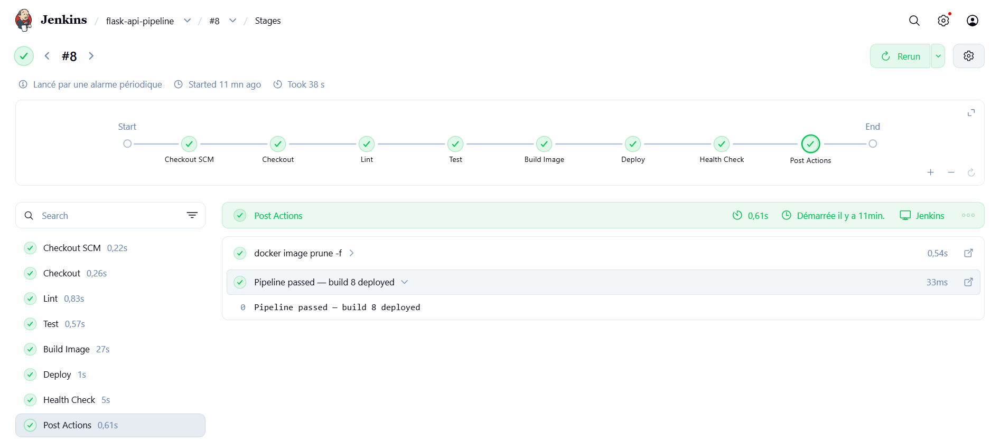
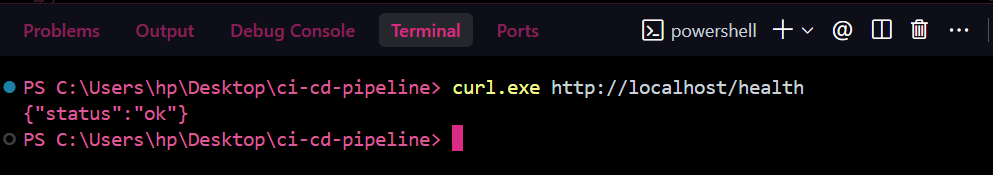
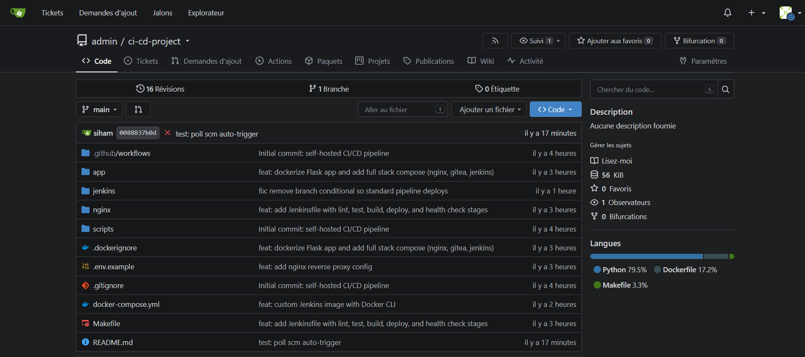
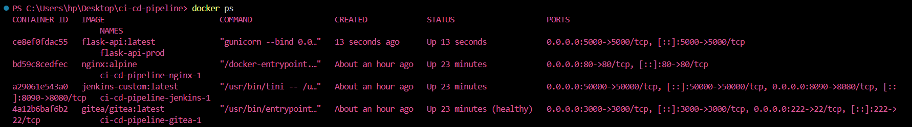

# Self-Hosted CI/CD Pipeline

A complete CI/CD pipeline that automatically lints, tests, builds, and deploys a Flask API on every push to `main` — built from scratch using Docker, Gitea, Jenkins, Nginx, and Python.

---

## Architecture

```text
┌─────────────────────────────────────────────────────────────┐
│ Docker Host (Local / EC2)                                   │
│                                                             │
│ Developer                                                   │
│     │                                                       │
│     │ git push                                              │
│     ▼                                                       │
│ ┌─────────┐      webhook       ┌───────────┐                │
│ │  Gitea  │ ─────────────────► │  Jenkins  │                │
│ │  :3000  │                    │   :8090   │                │
│ └─────────┘                    └─────┬─────┘                │
│                                      │                      │
│                                lint → test → build          │
│                                      │                      │
│                                      ▼                      │
│                                ┌───────────────┐            │
│                                │ flask-api-prod│ (container)│
│                                │     :5000     │            │
│                                └───────┬───────┘            │
│                                        │                    │
│ User ─────► ┌─────────┐                │                    │
│             │  Nginx  │ ───────────────┘                    │
│             │   :80   │ proxy_pass                          │
│             └─────────┘                                     │
│                                                             │
└─────────────────────────────────────────────────────────────┘
```

---

## Screenshots

### 1. Automated Jenkins Pipeline

*The pipeline automatically lints, tests, builds, and deploys the Flask API.*

### 2. Live Application Health Check

*Nginx successfully routing traffic to the newly deployed container.*

### 3. Self-Hosted Git Repository

*Gitea acting as the trigger source for the CI/CD pipeline.*

### 4. Docker Orchestration

*The full stack running locally (Nginx, Gitea, Jenkins, and the Flask API).*

---

## Stack

| Tool | Purpose |
|---|---|
| **Flask** | Task manager API (the target being deployed) |
| **pytest** | Unit tests for all API routes |
| **flake8** | Python code quality / linting |
| **Docker** | Containerization of the API |
| **Docker Compose** | Runs the full infrastructure stack |
| **Gitea** | Self-hosted Git server (trigger source) |
| **Jenkins** | CI/CD engine that runs the pipeline |
| **Nginx** | Reverse proxy in front of the deployed API |
| **Gunicorn** | Production WSGI server |

---

## How It Works

1. Developer pushes code to the `main` branch on **Gitea** (self-hosted Git).
2. **Jenkins** automatically detects the change (via Poll SCM every 60 seconds) and starts the pipeline.
3. Jenkins reads the **Jenkinsfile** and executes the following stages:
   - **Lint**: Runs `flake8` to ensure code quality and style.
   - **Test**: Runs `pytest` to execute 11 unit tests. If any fail, the pipeline stops.
   - **Build Image**: Builds a new Docker image tagged with the Jenkins `BUILD_NUMBER`.
   - **Deploy**: Stops the old `flask-api-prod` container and spins up the new one.
   - **Health Check**: Hits the `/health` endpoint via `curl` to verify the new container is live and serving traffic.
4. **Nginx** acts as a reverse proxy, routing external traffic from port 80 to the Flask container.

---

## Project Structure

```text
ci-cd-pipeline/
├── app/
│   ├── app.py             # Flask task manager API
│   ├── requirements.txt   # Pinned dependencies
│   ├── Dockerfile         # API image
│   ├── .dockerignore
│   └── tests/
│       └── test_app.py    # pytest suite
├── nginx/
│   └── nginx.conf         # Reverse proxy config
├── jenkins/
│   ├── Jenkinsfile        # Pipeline definition
│   └── Dockerfile         # Jenkins + Docker CLI image
├── docker-compose.yml     # Full stack
├── .env.example
├── .gitignore
└── README.md
```

---

## API Endpoints

| Method | Route | Description |
|---|---|---|
| GET | `/health` | Health check for Jenkins |
| GET | `/tasks` | List all tasks |
| GET | `/tasks/<id>` | Get one task |
| POST | `/tasks` | Create a task (`{"title": "..."}`) |
| PUT | `/tasks/<id>` | Update a task |
| DELETE | `/tasks/<id>` | Delete a task |

---

## Setup

### Prerequisites
- Docker
- Docker Compose
- Git

### Run the full stack

```bash
# 1. Clone
git clone https://github.com/youruser/ci-cd-pipeline.git
cd ci-cd-pipeline

# 2. Configure environment
cp .env.example .env
# edit .env and set FLASK_SECRET_KEY

# 3. Start infrastructure (Nginx + Gitea + Jenkins)
docker compose up -d

# 4. Check status
docker compose ps
```
---

### Important Windows/Docker Desktop Fix
If Jenkins fails during the Deploy stage with a "permission denied" error for `docker.sock`, run this command to grant Jenkins access to the Docker daemon:

```bash
docker compose exec -u root jenkins chmod 666 /var/run/docker.sock
```
---

## First-time service setup

### Gitea → http://localhost:3000

- Complete initial install (SQLite, admin account)
- Create repo `ci-cd-project`
- Push your code:
```bash
git remote add gitea http://localhost:3000/admin/ci-cd-project.git
git push gitea main
```

### Jenkins → http://localhost:8090

- Get initial password:
```bash
docker compose exec jenkins cat /var/jenkins_home/secrets/initialAdminPassword
```
- Install suggested plugins + Docker Pipeline
- Add credentials:
**gitea-credentials (username/password)**
**FLASK_SECRET_KEY (secret text)**
- Create a Pipeline job → "Pipeline script from SCM" → point to your Gitea repo → script path: **jenkins/Jenkinsfile**

### Webhook (in Gitea repo → Settings → Webhooks)

- URL: `http://jenkins:8080/gitea-webhook/post`
- Content type: application/json
- Trigger: Push events only

### Verify
```bash
curl http://localhost/health
# → {"status": "ok"}
```

---

## Common Commands
```bash
docker compose up -d          # start everything
docker compose down           # stop (keep volumes)
docker compose down -v        # stop + wipe volumes
docker compose logs -f        # stream logs
docker compose ps             # status
docker compose exec jenkins docker ps
```
---

## What I Learned
- How a webhook connects two services end-to-end
- Why health checks matter more than depends_on in Docker Compose
- How Docker networking resolves service names via internal DNS
- Why Nginx resolves upstreams at startup (and how to fix it with resolver)
- How Jenkins decides pass/fail based on shell exit codes
- Why Docker CLI must be added to a Jenkins image, mounting the socket isn't enough

---

## Challenges & Learnings

Building this locally on Windows with Docker Desktop presented several real-world DevOps challenges:
- **Docker Socket Permissions**: Jenkins failed to execute Docker commands because it lacked permissions to `/var/run/docker.sock`. Solved by updating the Jenkins `Dockerfile` and applying the correct group permissions.
- **Docker Networking & Egress Policies**: Windows Docker Desktop's network isolation blocked the Gitea-to-Jenkins webhook. Implemented **Poll SCM** as a reliable fallback for local development, simulating production webhook behavior.
- **Python Environment Isolation**: Resolved `ModuleNotFoundError` by explicitly using `python3 -m pip` and `python3 -m pytest` inside the Jenkins pipeline to avoid global vs. local package conflicts.
- **Nginx Upstream Resolution**: Nginx crashed on first boot because the Flask container didn't exist yet. Solved by using Docker's internal DNS resolver (`resolver 127.0.0.11`) to resolve the upstream at request-time rather than startup.

---

## License
MIT
